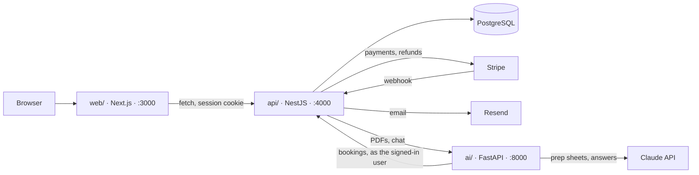

# Consultly

Book and pay independent consultants in one step. Clients find an expert, pick times in their own time zone, pay once with Stripe, and attach a PDF brief that AI turns into a one-page prep sheet for the consultant. Consultants set their hours, see their sessions, and cancel with automatic refunds. A Help assistant answers questions about the site and your own bookings.

A portfolio project: payments run in Stripe **test mode**, and both AI features have a free **demo mode** that works without an API key.


| AI prep sheet from a PDF brief | My bookings |
|---|---|
|  |  |

## What it does

**For clients**
- Browse, search, filter and sort consultants; see real open times in your own time zone, up to 60 days ahead (week or month view)
- Book one or several sessions and pay once with Stripe Checkout; times are held while you pay, and double booking is impossible
- Sign in with an emailed one-time link (no passwords) to see upcoming and past bookings
- Cancel free of charge until 24 hours before a session, with an automatic refund for that session
- Attach a PDF brief to a booking; it becomes a prep sheet both you and the consultant can read

**For consultants**
- Self-serve sign-up from the profile page; set weekly hours and time off; pause your listing
- Dashboard with earnings, a week/month calendar, upcoming and past sessions, and each client's brief
- Cancel a session and the client is refunded and emailed

**Help assistant**
- A Help bubble on every page, answering from the site's help topics and, when signed in, your own bookings (read-only)
- A **Demo / Live AI** switch: Demo uses pre-written answers and never calls the API

## How it fits together



- **web/**: Next.js 16, React 19, Tailwind CSS 4. Pages and UI only; it never touches the database.
- **api/**: NestJS 12, Prisma 7, PostgreSQL. All business rules: availability, holds, orders, Stripe Checkout and refunds, sign-in, briefs, rate limits.
- **ai/**: Python 3.12, FastAPI, pypdf, Anthropic SDK. Reads PDFs, writes prep sheets with structured outputs, and runs the Help assistant with one read-only tool.

Key design choices: times are stored in UTC and availability in the consultant's local time (Luxon handles daylight saving); a partial unique index makes double booking impossible at the database level; Stripe webhooks are verified and idempotent; sign-in tokens and sessions are stored only as hashes behind an httpOnly cookie.

## Running it locally

### Prerequisites
- Node.js 22 or newer, and npm
- PostgreSQL 15 or newer
- [uv](https://docs.astral.sh/uv/) (it installs Python 3.12 for the AI service)
- [Stripe CLI](https://docs.stripe.com/stripe-cli) and a Stripe account in test mode
- Optional: a [Resend](https://resend.com) API key (emails) and an [Anthropic](https://console.anthropic.com) API key (live AI)

### 1. Configure
Copy each template and fill in your own values. The real `.env` files are git-ignored.

```bash
cp api/.env.example api/.env        # database, Stripe, email
cp web/.env.example web/.env.local  # where the API runs
cp ai/.env.example ai/.env          # optional: Anthropic key and model
createdb consultly
```

### 2. Install, migrate, seed
```bash
cd api && npm install && npx prisma migrate deploy && npx prisma db seed && cd ..
cd web && npm install && cd ..
cd ai && uv sync && cd ..
```
The seed adds 10 consultants with weekly hours. It is idempotent: re-running it never deletes bookings.

### 3. Start the four processes (one terminal each)
```bash
cd api && npm run start:dev                                   # http://localhost:4000
cd web && npm run dev                                         # http://localhost:3000
cd ai && uv run uvicorn ai.main:app --port 8000 --reload      # http://127.0.0.1:8000
stripe listen --forward-to localhost:4000/stripe/webhook \
  --events checkout.session.completed,checkout.session.expired
```
`stripe listen` prints a signing secret (`whsec_...`): put it in `api/.env` as `STRIPE_WEBHOOK_SECRET`. Pay with Stripe's test card `4242 4242 4242 4242`.

### 4. Optional demo data
To sign in as a consultant, set `DEMO_CONSULTANT_EMAIL` in `api/.env` to your address before seeding. To attach the two sample PDF briefs to existing bookings:
```bash
cd api && npm run seed:briefs
```

## Configuration

| Where | Variable | Purpose |
|---|---|---|
| `api/.env` | `DATABASE_URL` | PostgreSQL connection (use `127.0.0.1` rather than `localhost`) |
| | `STRIPE_SECRET_KEY`, `STRIPE_WEBHOOK_SECRET` | Stripe test-mode key and the webhook signing secret |
| | `RESEND_API_KEY`, `EMAIL_FROM` | Optional. Without a key, emails are printed in the API console. In development, if a send fails, the sign-in link is shown on screen instead |
| | `AI_URL`, `UPLOAD_DIR` | Where the AI service runs; where brief PDFs are stored (default `./uploads`) |
| | `DEMO_CONSULTANT_EMAIL`, `DEMO_CLIENT_EMAIL` | Optional, for demo data |
| | `DEMO_LOGIN` | `true` shows "Try the demo": each visitor gets a private demo client and their own copy of consultant Jason Jefferson, which they can reset (for the deployed portfolio site) |
| | `AI_DAILY_CHAT_LIMIT`, `AI_DAILY_BRIEF_LIMIT` | Daily caps on Claude calls (defaults 200 and 30); past them the app falls back to demo answers |
| | `SUPABASE_URL`, `SUPABASE_SERVICE_ROLE_KEY`, `SUPABASE_BUCKET` | Deployed: store brief PDFs in a private Supabase Storage bucket instead of on disk |
| | `AI_SERVICE_TOKEN` | Deployed: shared secret between the API and the AI service (set the same value in both) |
| `web/.env.local` | `NEXT_PUBLIC_API_URL` | Where the browser reaches the API (`/api` when deployed, forwarded by Next.js) |
| | `API_INTERNAL_URL` | Deployed: the API's real address, for that forwarding and server rendering |
| `ai/.env` | `ANTHROPIC_API_KEY` | Optional. Without it, briefs are stored without a summary and the Help chat answers in demo mode |
| | `CLAUDE_MODEL` | Optional. Defaults to `claude-haiku-5-5`, the cheapest model |
| | `API_URL`, `AI_SERVICE_TOKEN` | Deployed: the API's address and the shared secret |

## Tests
```bash
cd api && npm test     # NestJS: orders, refunds, auth, availability, profiles, briefs, support chat
cd web && npm test     # date, calendar, pagination and sorting helpers
cd ai && uv run pytest # PDF reading, prep sheets, Help assistant (no API calls)
```
No test calls Stripe, Resend or Claude; all three are replaced with fakes.

## Deploying

`render.yaml` describes the API and AI service for Render's free plan; the website deploys to Vercel (root directory `web`, with `NEXT_PUBLIC_API_URL=/api` and `API_INTERNAL_URL` set to the API's address), and the database and PDF storage live on Supabase. Stripe needs a webhook endpoint pointing at `<api>/stripe/webhook`.

AI spending is capped in three layers: Live AI requires sign-in, the API enforces daily caps stored in the database, and a monthly limit in the Anthropic Console is the final backstop.

## Before a real launch
- Verify a sending domain in Resend; in test mode it only delivers to the account owner's address.
- Move the per-visitor rate limits from memory to a shared store (for example Redis) once there's more than one server.
- Add admin review before new consultant profiles go live, and a rate limit on sign-in emails.
- Set `NODE_ENV=production`: it switches off the on-screen sign-in link and the model label in the Help chat.
