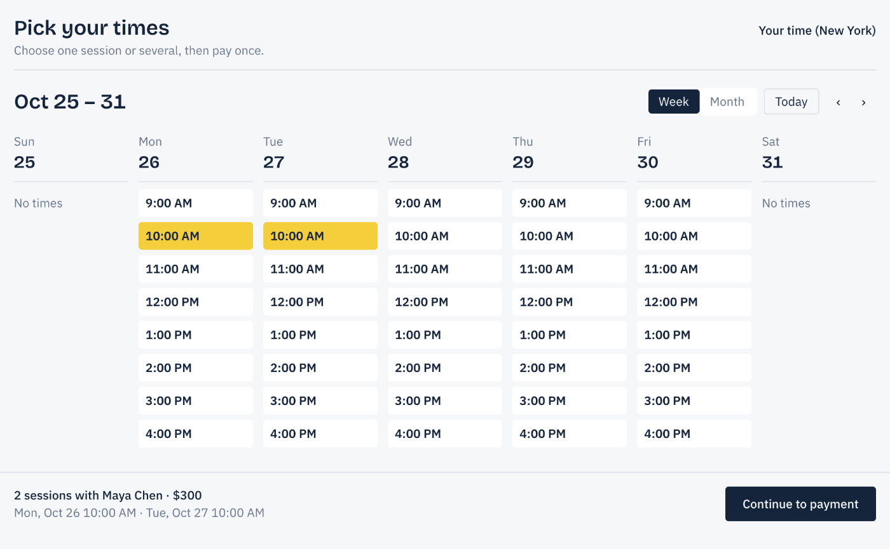
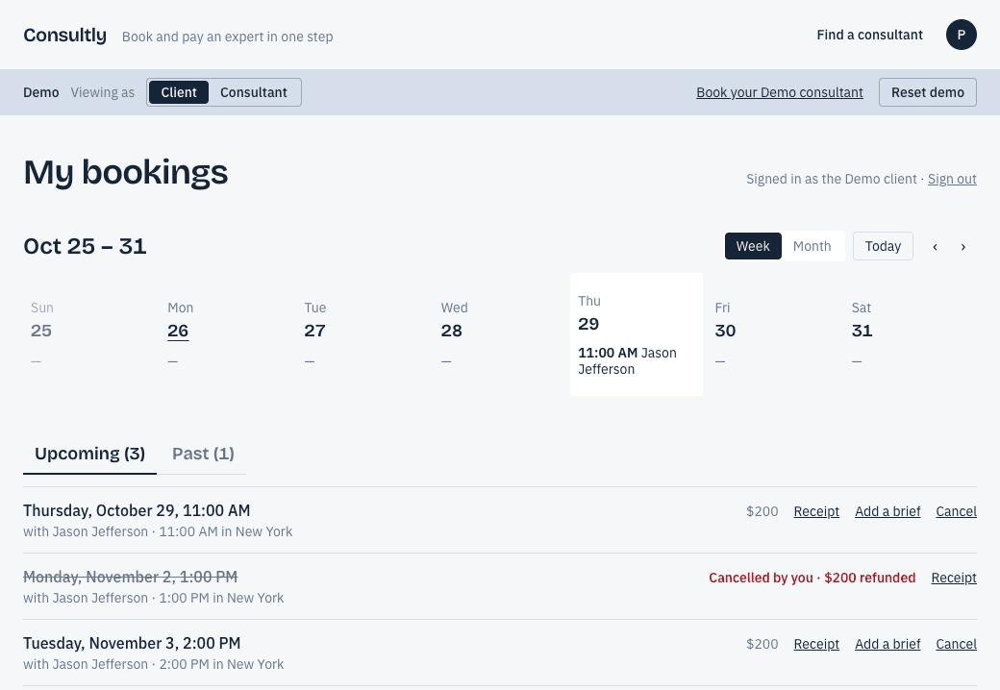
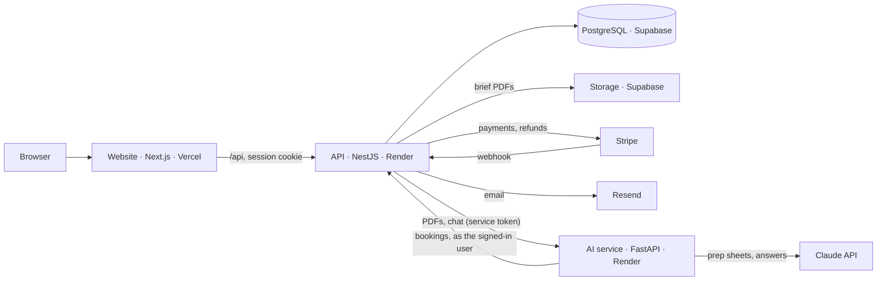

# Consultly

Book and pay independent consultants in one step. Clients find an expert, pick times in their own time zone, pay once with Stripe, and attach a PDF brief that AI turns into a one-page prep sheet for the consultant. Consultants set their hours, see their sessions, and cancel with automatic refunds. A Help assistant answers questions about the site and your own bookings.

**Live site: [consultly-alpha.vercel.app](https://consultly-alpha.vercel.app)**

A portfolio project: payments run in Stripe **test mode**, so no real money moves.

> **The first visit may take up to a minute.** The site runs on free hosting, where the servers sleep after 15 minutes without visitors and start again on the next visit. After that, pages load normally. The AI assistant sleeps separately; opening Help wakes it.



| AI prep sheet from a PDF brief | My bookings |
|---|---|
|  |  |

## Try it

1. Open **My bookings** and choose **Explore as a client**. No email needed: you get a private demo that nobody else sees, with a few sessions already booked.
2. Use **Book your Demo consultant** to book a session, and pay with Stripe's test card `4242 4242 4242 4242` (any future date, any CVC).
3. Add a PDF brief to a booking and read the prep sheet the AI writes from it.
4. Switch **Viewing as: Consultant** in the demo bar to see the same sessions from the consultant's dashboard.
5. Ask the **Help** assistant something like "When is my next session?" (Live AI needs the demo sign-in).
6. **Reset demo** puts everything back to the defaults.

The free 30-minute **Consultly Onboarding** call (first in the consultant list) books without payment.

## What it does

**For clients**
- Browse, search, filter and sort consultants; see real open times in your own time zone, up to 60 days ahead (week or month view)
- Book one or several sessions and pay once with Stripe Checkout; times are held while you pay, released if you leave without paying, and double booking is impossible
- Sign in with an emailed one-time link (no passwords) to see upcoming and past bookings
- Cancel free of charge until 24 hours before a session, with an automatic refund for that session
- Attach a PDF brief to a booking; it becomes a prep sheet both you and the consultant can read

**For consultants**
- Self-serve sign-up from the profile page; choose 30- or 60-minute sessions; set weekly hours and time off; pause your listing
- Dashboard with earnings, a week/month calendar, upcoming, past and cancelled sessions, and each client's brief
- Cancel a session and the client is refunded and emailed

**Help assistant**
- A Help bubble on every page, answering from the site's help topics and, when signed in, your own bookings (read-only)
- A **Demo / Live AI** switch: Demo uses pre-written answers and never calls the AI model

## Stack

| Part | Built with | Hosted on |
|---|---|---|
| Website (`web/`) | Next.js 16, React 19, Tailwind CSS 4 | Vercel |
| API (`api/`) | NestJS 12, Prisma 7, TypeScript | Render |
| AI service (`ai/`) | Python 3.12, FastAPI, pypdf, Anthropic SDK (Claude Haiku) | Render |
| Database and PDF storage | PostgreSQL, Supabase Storage | Supabase |
| Payments, email | Stripe Checkout (test mode), Resend | |

## How it fits together



- **Website:** pages and UI only; it never touches the database. The browser calls `/api` on the website, which forwards to the API, so the sign-in cookie stays first-party.
- **API:** all business rules: availability, holds, orders, Stripe Checkout and refunds, sign-in, briefs, demo accounts, rate limits and AI spending caps.
- **AI service:** reads PDFs, writes prep sheets with structured outputs, and runs the Help assistant with one read-only tool. It only accepts requests from the API.

Key design choices:
- Times are stored in UTC and availability in the consultant's local time (Luxon handles daylight saving).
- A partial unique index makes double booking impossible at the database level.
- Stripe webhooks are verified and idempotent.
- Sign-in tokens and sessions are stored only as hashes behind an httpOnly cookie.
- AI spending is capped in three layers: Live AI requires sign-in, the API enforces daily caps stored in the database, and a monthly limit in the Anthropic Console is the final backstop.

## Tests

```bash
cd api && npm test     # NestJS: orders, refunds, auth, demo accounts, availability, profiles, briefs, support chat
cd web && npm test     # API helpers, date, calendar, pagination and sorting
cd ai && uv run pytest # PDF reading, prep sheets, Help assistant
```

No test calls Stripe, Resend or Claude; all three are replaced with fakes.

## Before a real launch

- Verify a sending domain in Resend; on the test sender it only delivers to the account owner's address.
- Move the per-visitor rate limits from memory to a shared store (for example Redis) once there's more than one server.
- Add admin review before new consultant profiles go live.
- Keep the servers awake (paid plans), so no visitor waits for a cold start.
