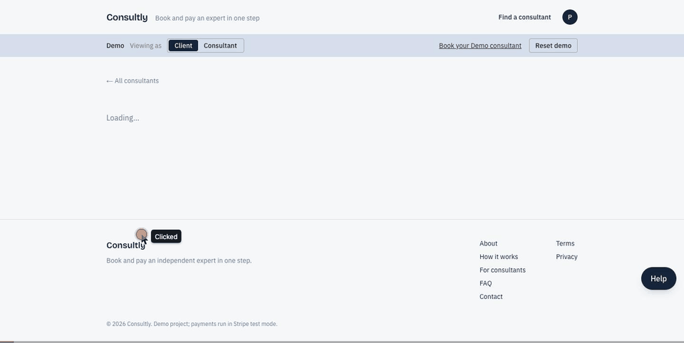
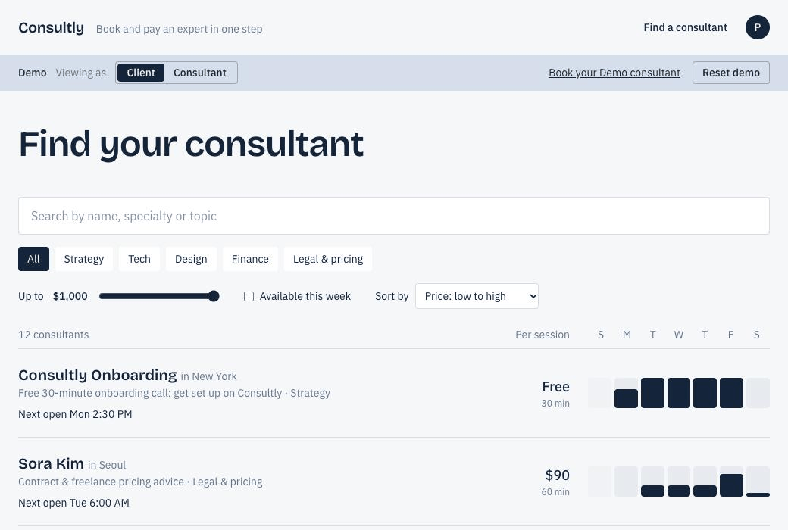
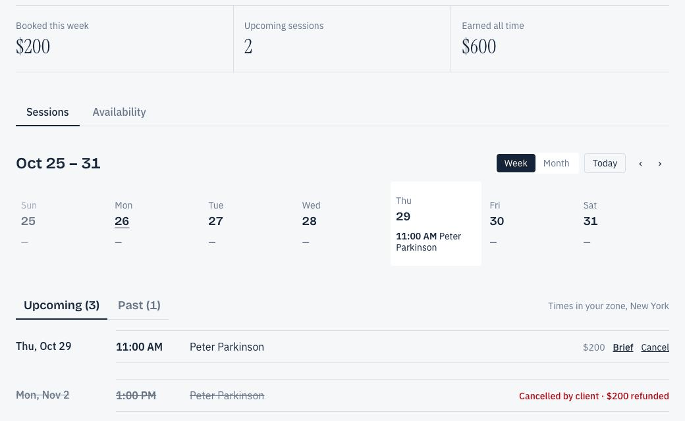
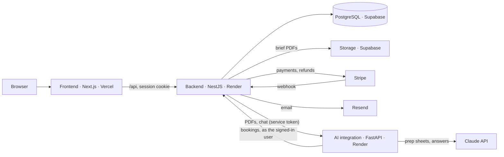

# Consultly

Book and pay independent consultants in one step. Clients find an expert, pick times in their own time zone, pay once with Stripe, and attach a PDF brief that AI turns into a one-page prep sheet for the consultant. Consultants set their hours, see their sessions, and cancel with automatic refunds. A Help assistant answers questions about the site and your own bookings.

**Live site: [consultly-alpha.vercel.app](https://consultly-alpha.vercel.app)**

A portfolio project: payments run in Stripe **test mode**, so no real money moves.

> **The first visit may take up to a minute.** The site runs on free hosting, where the servers sleep after 15 minutes without visitors and start again on the next visit. After that, pages load normally.

## What it does

**For clients**
- Browse, search, filter and sort consultants; see real open times in your own time zone, up to 60 days ahead (week or month view)
- Book one or several sessions and pay once with Stripe Checkout; times are held while you pay, released if you leave without paying, and double booking is impossible
- Sign in with an emailed one-time link (no passwords) to see upcoming and past bookings
- Cancel free of charge until 24 hours before a session, with an automatic refund for that session
- Attach a PDF brief to a booking; it becomes a prep sheet both you and the consultant can read

**For consultants**
- Self-serve sign-up from the profile page; choose 30- or 60-minute sessions; set weekly hours and time off; pause your listing
- Dashboard with earnings, a week/month calendar, upcoming and past sessions, and each client's brief
- Cancel a session and the client is refunded and emailed

**Help assistant**
- A Help bubble on every page, answering from the site's help topics and, when signed in, your own bookings (read-only)
- A **Demo / Live AI** switch: Demo uses pre-written answers and never calls the AI

## Demo



| Find a consultant | Pick your times |
|---|---|
|  |  |

| AI prep sheet from a PDF brief | My bookings |
|---|---|
|  |  |



### Try it

1. Open **My bookings** and choose **Explore as a client**. No email needed: you get a private demo that nobody else sees, with a few sessions already booked.
2. Use **Book your Demo consultant** in the demo bar (or search for Jason in **Find a consultant**) to book a session, and pay with Stripe's test card `4242 4242 4242 4242` (any future date, any CVC).
3. Add a PDF brief to a booking and read the prep sheet the AI writes from it.
4. Switch **Viewing as: Consultant** in the demo bar to see the same sessions from the consultant's dashboard.
5. Ask the **Help** assistant something like "When is my next session?" (Live AI needs the demo sign-in).
6. **Reset demo** puts everything back to the defaults.

The free 30-minute **Consultly Onboarding** call (first in the consultant list) books without payment.

## Stack

- **Languages:** [TypeScript](https://www.typescriptlang.org), [Python](https://www.python.org), SQL
- **Frontend:** [Next.js](https://nextjs.org), [React](https://react.dev), [Tailwind CSS](https://tailwindcss.com)
- **Backend:** [NestJS](https://nestjs.com), [Prisma](https://www.prisma.io), REST APIs, passwordless authentication, webhooks, rate limiting
- **Data & storage:** [PostgreSQL](https://www.postgresql.org), [Supabase Storage](https://supabase.com/docs/guides/storage) (brief PDFs)
- **AI integration:** [FastAPI](https://fastapi.tiangolo.com), [Claude API](https://www.anthropic.com/api), PDF text extraction ([pypdf](https://pypdf.readthedocs.io)), chat with an AI agent that can look up your bookings
- **Payments & email:** [Stripe](https://stripe.com) (test mode), [Resend](https://resend.com)
- **Hosting:** [Vercel](https://vercel.com) (frontend), [Render](https://render.com) (backend and AI integration), [Supabase](https://supabase.com) (database and storage)
- **Tools:** [GitHub Actions](https://github.com/features/actions) (scheduled health checks), [uv](https://docs.astral.sh/uv/), [Git](https://git-scm.com)
- **Reliability:** health checks, error and cold-start handling, database outage reporting, unit testing ([Vitest](https://vitest.dev) and [pytest](https://docs.pytest.org))

## AI safeguards

- Live AI requires sign-in; visitors who aren't signed in get demo answers.
- Daily usage caps, stored in the database; past them, answers fall back to demo mode.
- The AI service only accepts requests from the backend, which applies the rules above.
- A monthly spending limit on the Claude API account is the final backstop.

## How it works

### Design overview



- **Frontend:** pages and UI only; it never touches the database. The browser calls `/api` on the frontend, which forwards to the backend, so the sign-in cookie stays first-party.
- **Backend:** all business rules: availability, holds, orders, Stripe Checkout and refunds, sign-in, briefs, demo accounts, rate limits and AI usage caps.
- **AI integration:** reads PDFs, writes prep sheets, and runs the Help assistant, which can look up the signed-in user's bookings and nothing else.

### Key points

- Times are stored in UTC and availability in the consultant's local time, so daylight saving is handled correctly.
- A partial unique index makes double booking impossible at the database level.
- Stripe webhooks are verified and idempotent, and payments for unknown orders are acknowledged rather than retried.
- Sign-in tokens and sessions are stored only as hashes behind an httpOnly cookie.

### Architecture notes

- **Private demo per visitor:** "Try the demo" creates a client and a private copy of a consultant for each visitor, with sample sessions, so visitors never see each other's data. Unused demos are removed automatically.
- **Sleeping servers:** the backend and AI integration sleep when idle on the free plan. Pages say when the server is waking up, AI calls wait and retry while it starts, and opening Help or a booking's brief wakes the AI integration in advance.
- **Database monitoring:** a GitHub Action calls a database health check every 3 days. It keeps the free database from pausing, and a failed run emails the owner.
- **Single-server limits:** per-visitor rate limits are kept in memory, which suits one server; more servers would need a shared store such as Redis.

### More detail

- [Architecture](docs/architecture.md): the data model and how booking, payment, sign-in, briefs, the Help assistant and demo accounts work.
- [Key decisions](docs/decisions.md): 14 choices that shaped the system, with the alternatives and trade-offs.
- [Running and deploying](docs/deployment.md): local setup, hosting on Vercel, Render and Supabase, and every setting.

## Tests

```bash
cd api && npm test     # backend: orders, refunds, auth, demo accounts, availability, profiles, briefs, support chat
cd web && npm test     # frontend helpers: API calls, dates, calendar, pagination and sorting
cd ai && uv run pytest # AI integration: PDF reading, prep sheets, Help assistant
```

No test calls Stripe, Resend or Claude; all three are replaced with fakes.

## Running locally

See [Running and deploying](docs/deployment.md#run-it-locally): Node.js, PostgreSQL, uv and the Stripe CLI, then four processes (backend, frontend, AI integration and `stripe listen`).
