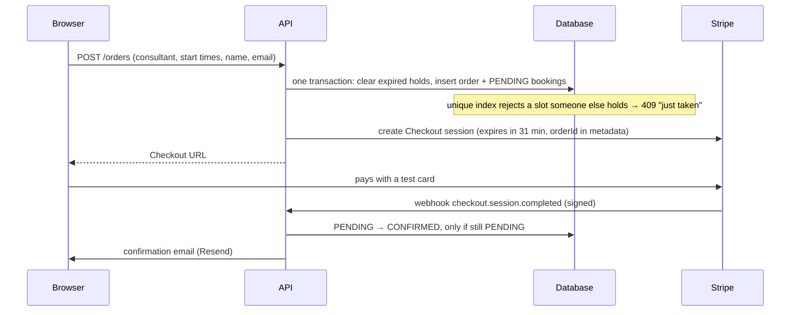

# Architecture

How Consultly's parts fit together, and what happens inside them when someone books, pays, signs in, adds a brief or asks for help. The README has the one-picture overview; this goes one level deeper. The reasons behind the choices are in [decisions.md](decisions.md).

## The parts

| Part       | Folder | Owns                                                                                                        | Talks to                                                       |
| ---------- | ------ | ----------------------------------------------------------------------------------------------------------- | -------------------------------------------------------------- |
| Website    | `web/` | Pages and UI. No database access, no secrets.                                                               | The API, through `/api` on its own address                     |
| API        | `api/` | Every business rule and all data: consultants, availability, orders, sign-in, briefs, demo accounts, limits | PostgreSQL, Supabase Storage, Stripe, Resend, the AI service   |
| AI service | `ai/`  | Reading PDFs, writing prep sheets, the Help assistant. Stores nothing.                                      | Claude; the API (only to read a user's bookings, as that user) |

One rule holds everywhere: **only the API changes data.** The website asks the API; the AI service answers the API and, for the Help assistant, reads from the API with the user's own session.

```
Browser ─▶ Website (Vercel) ─/api─▶ API (Render) ─▶ PostgreSQL + Storage (Supabase)
                                      │  ▲    └──▶ Stripe, Resend
                         service token│  │webhook
                                      ▼  │
                           AI service (Render) ─▶ Claude
```

## Data

`api/prisma/schema.prisma` is the source of truth. Each change to it comes with a migration in `api/prisma/migrations/`: a dated SQL file that brings an existing database up to date. Migrations run in order, and every API deploy applies any new ones.

The tables and how they relate:

```
Consultant ─┬─ Availability   weekly hours, in the consultant's own time zone
            ├─ TimeOff        away periods, as exact instants
            └─ Order ──┬─ Booking   one session; exact UTC start and end
                       └─ Brief     the PDF and its prep sheet (one per order)

Client       name and time zone, keyed by email
LoginToken   one-time sign-in links (hash only)
Session      signed-in browsers (hash only)
AiUsage      live AI calls per day, for the daily caps
```

- **Order vs Booking.** An order is one checkout: one client, one consultant, one payment, up to 6 sessions. Each session is a booking. A booking's status copies its order's, except when one session is cancelled and refunded on its own.
- **Statuses.** `PENDING` (held while paying), `CONFIRMED` (paid), `CANCELLED`.
- **Identity is the email.** There's no user table. A signed-in email is a client. It's also a consultant when a `Consultant` row has that email.
- **Demo rows.** A demo visitor's private consultant copy has `demoOwner` set, which keeps it out of the public catalogue.

## Flows

### Finding a time

1. The consultant list and profile pages load consultants and their open times (`GET /consultants`, `GET /consultants/:id/slots`).
2. The API builds open times on the fly (`api/src/consultants/slots.ts`). It takes the weekly hours in the consultant's zone, turns each day into exact instants with Luxon (so daylight saving is handled), and removes past times, time off and active bookings. The window is 60 days.
3. The browser shows every time in the visitor's own zone.

### Booking and paying



- **The hold.** Bookings are `PENDING` while the client is on Stripe's page. The hold ends when the Checkout session expires (31 minutes; Stripe's minimum is 30). Then Stripe sends `checkout.session.expired` and the order is cancelled. If the client clicks Back instead, the API expires the session right away and frees the times.
- **Double booking.** A partial unique index allows only one active booking per consultant and start time (`api/prisma/migrations/*_booking_active_slot`). Two clients clicking at the same moment can't both get the slot, whatever the code does.
- **The webhook is the only thing that confirms a payment.** The success page only reads the order. The webhook is verified against Stripe's signature using the raw request body. It's idempotent: the status change only happens from `PENDING`, and only the delivery that made the change sends the email.
- **Free sessions** (the onboarding call) skip Stripe and need sign-in.

### Cancelling and refunds

A consultant can cancel any session. A client can cancel until 24 hours before it starts. Either way the API refunds that one session's price on the order's payment, with a per-booking idempotency key (`refund-<bookingId>`) so a retry can't refund twice. Then it marks the booking cancelled, which reopens the slot, and emails both sides.

### Signing in

1. `POST /auth/magic-link` with an email. The API stores the SHA-256 hash of a random token (valid 15 minutes, single use) and emails the link.
2. Opening the link calls `POST /auth/verify`. The API checks the hash, marks the token used and creates a session. The `consultly_session` cookie holds a random id; the database stores only its hash. The cookie is httpOnly, SameSite=Lax and lasts 7 days.
3. `GET /me` returns the email, the client profile and the consultant profile when there is one. Pages use it to decide what to show.

The link is stored, as a hash, so the API can check three things when it's opened: that the API issued it, that it hasn't expired, and that it hasn't been used yet. A link that carries its own proof (a signed token) would need no storage, but it couldn't be made single-use: it would keep working for its whole lifetime, however often it was forwarded or opened. The stored rows also let the API count recent links per address for the rate limit.

Storing hashes rather than the tokens themselves means a leaked database exposes no working links or sessions.

### Briefs and prep sheets

1. The client uploads a PDF to `POST /me/orders/:orderId/brief` (paid orders only, until the first session starts, 10 MB max).
2. The API checks that the client owns the order, stores the file in the private Supabase bucket (local `uploads/` in development) and sends it to the AI service with the service token.
3. The AI service extracts the text with pypdf. If there's text, it asks Claude for a prep sheet in a fixed shape (a Pydantic schema, so the reply is always valid JSON). The brief's text is passed as data, not as instructions.
4. The API saves the result on the `Brief` row. A PDF with no text (a scan) gets a clear message instead. Without an Anthropic key the file is kept and the summary is marked unavailable.
5. The client and the consultant see the same prep sheet.

### Help assistant

1. The browser keeps the conversation in `sessionStorage` and sends it to `POST /support/chat`.
2. **Demo** mode answers from pre-written help topics and never calls Claude. **Live AI** needs a signed-in user and counts against a daily cap.
3. For Live AI, the API forwards the question to the AI service along with the user's session cookie. Claude gets one tool, `get_my_bookings`, and the AI service runs it by calling the API **as that user**. It can only ever see what the user could see on their own pages, and it can't change anything.

### Demo accounts

**Explore as a client** or **as a consultant** calls `POST /auth/demo`. The API creates a private pair for that browser: a client (Peter Parkinson) and a personal copy of the consultant (Jason Jefferson), with weekday hours and four sample sessions.

Every browser gets its own pair; no pair is shared. The first demo start sets a random token in the `consultly_demo` cookie, and the pair's emails are derived from it (`demo-client-<id>@consultly.test` and `demo-consultant-<id>@consultly.test`). Two visitors therefore see different Peters and different Jasons, with the same names. Nobody else can see that demo consultant.

Both sides sign in through the same session system as everyone else. Switching sides keeps the pair; **Reset demo** rebuilds it. Pairs unused for an hour are removed the next time someone starts a demo.

## Limits that protect the free tier

| What          | Limit                                                                                   | Where                                       |
| ------------- | --------------------------------------------------------------------------------------- | ------------------------------------------- |
| Sign-in links | 10 per hour per network; 3 per address per 15 minutes                                   | `auth.controller.ts`, `auth.service.ts`     |
| New demos     | 5 per minute and 30 per hour per network (switching sides is free)                      | `auth.controller.ts`                        |
| Checkouts     | 10 per hour per network; at most 6 held sessions and 2 upcoming free sessions per email | `orders.controller.ts`, `orders.service.ts` |
| Brief uploads | 5 per hour per signed-in email                                                          | `briefs.service.ts`                         |
| Help messages | 20 per 10 minutes per network                                                           | `support.controller.ts`                     |
| Live AI       | 200 chats and 30 briefs per day, stored in the database                                 | `ai-budget.service.ts`                      |

The per-network limits live in memory, which is fine for one server. They would need a shared store with more than one.

## Where to start reading

1. `api/prisma/schema.prisma`: the data, with comments.
2. `api/src/orders/orders.service.ts`: booking, holds, payment status, refunds.
3. `api/src/stripe/stripe-webhook.controller.ts`: how a payment becomes a confirmed booking.
4. `api/src/consultants/slots.ts`: turning weekly hours into open times.
5. `api/src/auth/`: sign-in, sessions, demo accounts.
6. `ai/src/ai/prep_sheet.py` and `ai/src/ai/support.py`: the two uses of Claude.
7. `web/app/consultants/[id]/`: the profile page and time picker, from the visitor's side.
